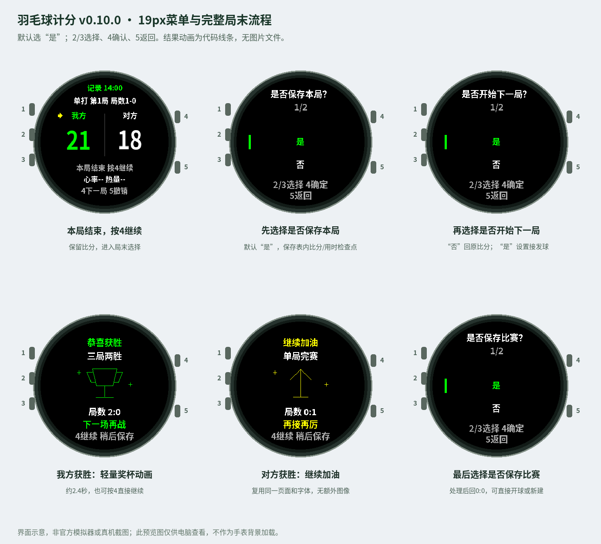
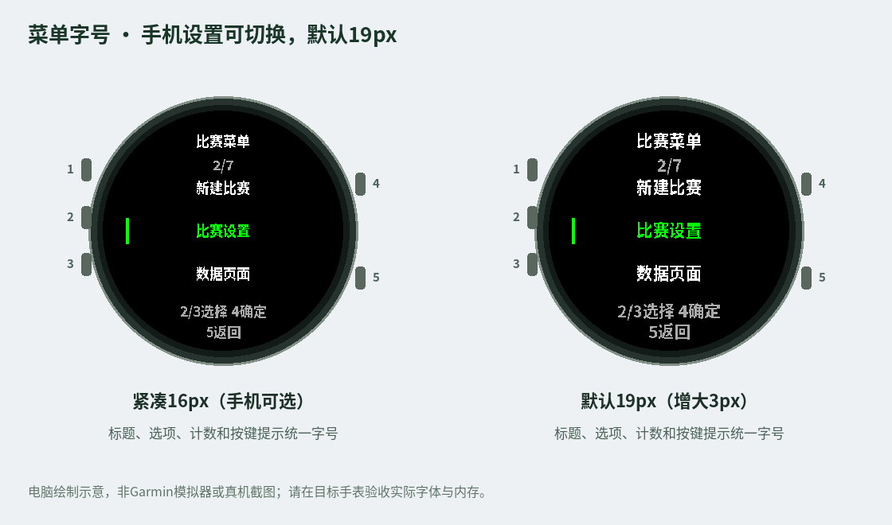
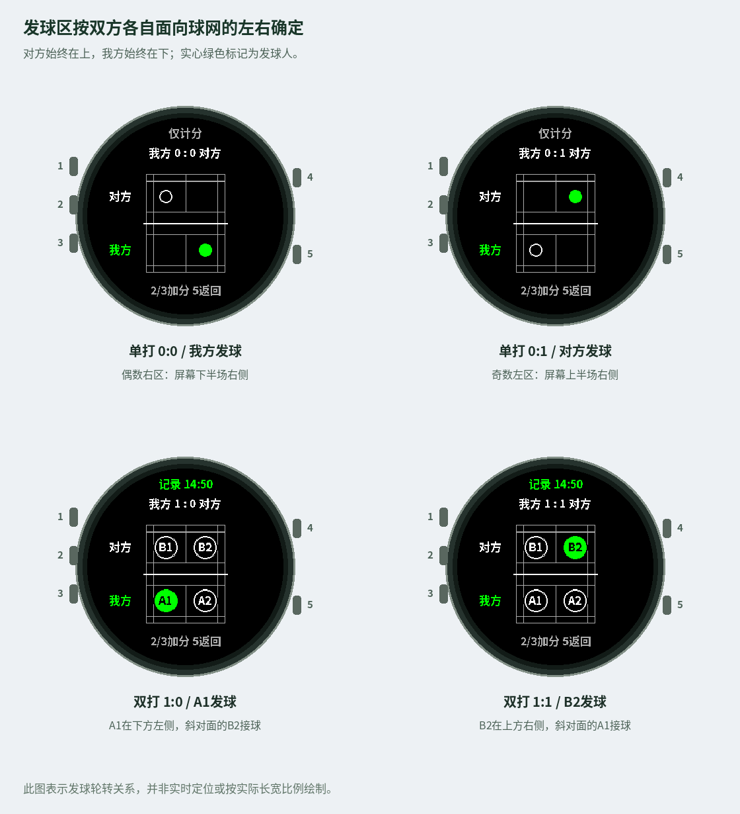

<div align="center">

# 羽毛球计分 · Garmin Badminton Score

**抬腕看比分，开球看站位。**

面向 Garmin Fēnix 6X Pro / Solar 的中文羽毛球运动应用。

[](https://github.com/yilongzhao1122/garmin-badminton-score/releases/latest)
[](manifest.xml)
[](LICENSE)

[**下载最新版**](https://github.com/yilongzhao1122/garmin-badminton-score/releases/latest) · [**中文使用说明**](docs/USER_GUIDE_CN.md) · [**安装与构建**](docs/INSTALL_CN.md) · [**English**](README_EN.md)

</div>



[中文](README.md) · [English](README_EN.md)

## 用手表完成一场比赛

- **单打 / 双打**：21分制，另有15分与11分练习制；单局赛或三局两胜。
- **两键计分**：2键我方得分，3键对方得分；黄色小箭头标记最近得分方。
- **接发球场图**：4键开球查看俯视场地、发球人及发球区；双打保留 A1/A2/B1/B2 编号。
- **比赛流程完整**：局末保存、下一局接发球设置、胜利或加油页面、整场保存或放弃。
- **中文循环菜单**：逐层返回，可更正接发球、撤销误记、锁定计分、查看数据与时钟。
- **运动记录**：开启记录后读取心率、热量和时长；保存普通 FIT 活动，再通过手表同步 Garmin Connect。
- **轻量绘制**：场地和结果效果使用线条、圆点绘制；缓存16px标签和19px菜单字库，无全屏背景图片。

菜单默认字号为19px；支持通过Connect IQ手机设置选择19px或16px。首次商店安装、字号同步和商店更新流程见 [Connect IQ 发布与手机设置](docs/CONNECT_IQ_CN.md)。



## 下载与安装

| 文件 | 用途 |
| --- | --- |
| [源码包 ZIP](https://github.com/yilongzhao1122/garmin-badminton-score/releases/latest/download/garmin-badminton-score-v0.10.0-source.zip) | 完整工程，通过自己的 SDK 和密钥构建 |
| [离线中文指南 HTML](https://github.com/yilongzhao1122/garmin-badminton-score/releases/latest/download/garmin-badminton-score-v0.10.0-guide-cn.html) | 下载后在电脑或手机浏览器阅读，图片已内嵌 |
| [离线英文指南 HTML](https://github.com/yilongzhao1122/garmin-badminton-score/releases/latest/download/garmin-badminton-score-v0.10.0-guide-en.html) | 英文安装与操作说明，图片已内嵌 |
| [SHA256SUMS.txt](https://github.com/yilongzhao1122/garmin-badminton-score/releases/latest/download/SHA256SUMS.txt) | 校验下载文件 |

**这是源码发行版，未提供预编译 PRG。** 先安装 Garmin 官方 Monkey C 扩展和 SDK，下载 `fenix6xpro` 设备包，运行 `Monkey C: Verify Installation`。VS Code 打开工程根目录，使用自己的 Developer Key，打开 `source/BadmintonApp.mc` → **Ctrl+F5 → fenix6xpro**。

通过模拟器验收后，使用 **Build for Device** 生成真实设备 PRG，通过 USB 复制到手表的 `GARMIN/APPS`。应用安装在手表；手机 Garmin Connect 用于活动同步，不能直接导入 MC 源码安装。详细步骤见[安装指南](docs/INSTALL_CN.md)。

## 五个按键

左侧由上至下为1/2/3，右侧由上至下为4/5。

| 按键 | 比分与场地图 | 菜单 |
| --- | --- | --- |
| 1 · LIGHT | 系统背光 | 系统背光 |
| 2 · UP | 短按我方 +1；长按打开菜单 | 上移，首尾循环 |
| 3 · DOWN | 对方 +1 | 下移，首尾循环 |
| 4 · START | 开球 / 下一局 / 查看结果 | 确定 |
| 5 · BACK | 场图回比分；比分页撤销 | 返回上一层 |

数据页上的2/3不加分。计分锁定与暂停运动分别控制；解锁后可继续计分。

## 从开球到保存

1. 长按2 → **新建比赛**，选择单双打、分制、比赛形式、接发球和是否记录运动。
2. 比分页按4开球，查看场地图；每球结束按2或3记分，自动回比分，再按4继续。
3. 一局结束但整场未结束：按4 → 是否保存本局 → 是否开始下一局 → 设置接发球 → 0:0准备。
4. 下一局选择“否”会保留刚结束的比分；可以再次按4进入。完成接发球选择前不会清分。
5. 整场结束：按4查看结果 → 是否保存比赛 → 回到0:0准备；应用保持打开，可以直接开始或新建。

21分制需领先2分、30分封顶；21:20不会结束。三局两胜先赢两局即结束。15/11分为练习设置，分别封顶21/15分。



对方始终在上，我方在下。偶数分在发球方**自己的右区**，奇数分在自己的左区；上半场的左右与屏幕左右相反。场图为接发球提示，不是实时定位。

## 记录保存到哪里

| 数据 | 保存与查看 |
| --- | --- |
| 心率、热量、运动时长 | 开启运动记录并保存后，生成普通 FIT；由手表同步至 Connect |
| 各局比分、用时、接发球与比赛结果 | 在手表应用中查看；保存最后一场归档 |
| 单局“保存” | 单独保存表内检查点，不拆分整场 FIT |
| Connect 中详细每局比分 | 默认不导出自定义 FIT 字段，不提供详细比分图表 |

活动使用通用运动类型，Connect 中可能显示为“其他”。不启用 GPS，不承诺室内距离或全部原生训练指标。心率尚未取得时显示 `--`，请等待有效采样。运动记录需要在真实手表上验证；模拟器活动不会直接同步手机。

## 开发与验证

无需第三方 Node 依赖，执行：

```sh
node tools/check_engine.cjs
node tools/check_recording.cjs
node tools/check_performance.cjs
node tools/check_serve_ui.cjs
```

当前 **166项 Node 逻辑 / 模拟 API 检查通过**，并提供25个 `Run No Evil` 原生格式测试。Node 检查不替代 Garmin SDK 编译、官方模拟器、真实堆内存或 Connect 同步验收。完整范围见 [VALIDATION.md](VALIDATION.md)。

开发说明见 [CONTRIBUTING.md](CONTRIBUTING.md)，代码结构见 [ARCHITECTURE.md](docs/ARCHITECTURE.md)。

## 许可与归属

源码采用 [MIT License](LICENSE)。`BadmintonCN` 点阵字体衍生自 Noto Sans CJK SC Bold，遵循 [SIL Open Font License 1.1](FONT_LICENSE.txt)。保留字体署名与许可。Garmin、Fēnix、Connect IQ 为其权利人的商标，本项目为独立项目。
