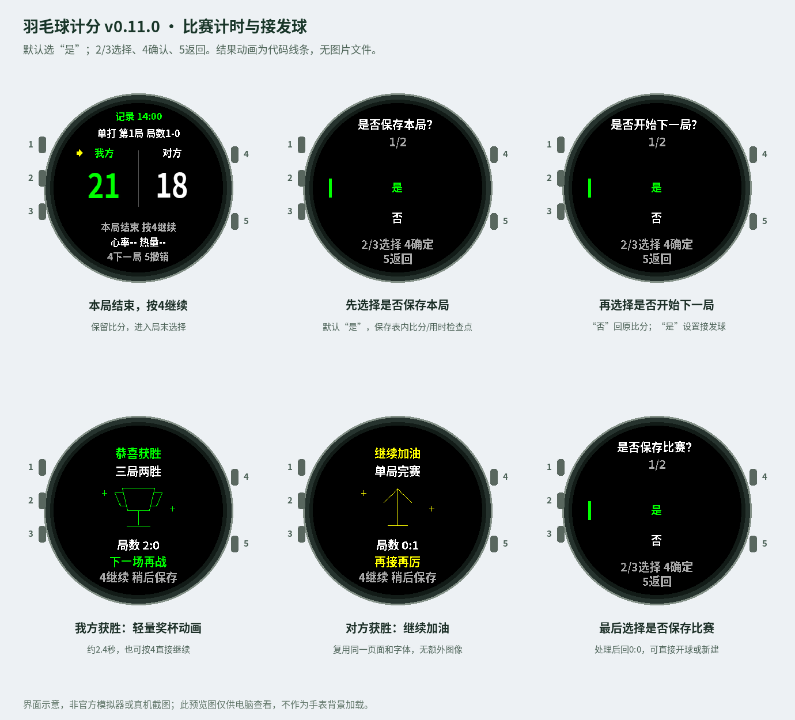
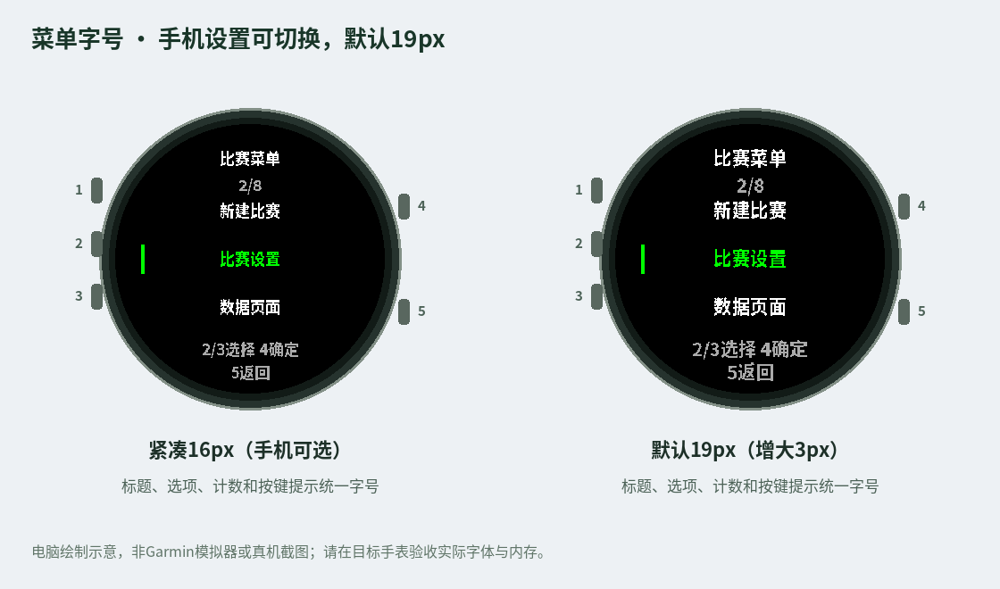
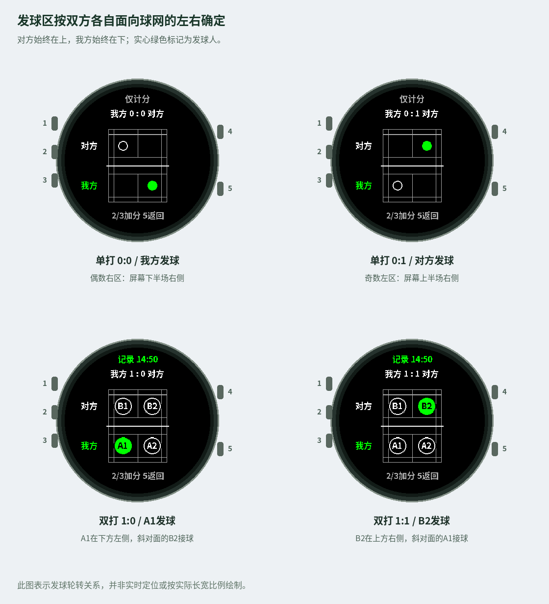

<div align="center">

# Garmin Badminton Score · 羽毛球计分

**Check the score. See who serves. Keep playing.**

A five-button badminton watch app for Garmin Fēnix 6X Pro / Solar.

[中文](README.md) · **English**

[](https://github.com/yilongzhao1122/garmin-badminton-score/releases/latest)
[](manifest.xml)
[](LICENSE)

[**Download**](https://github.com/yilongzhao1122/garmin-badminton-score/releases/latest) · [**User guide**](docs/USER_GUIDE_EN.md) · [**Build and install**](docs/INSTALL_EN.md) · [**中文说明**](docs/USER_GUIDE_CN.md)

</div>



## A match on your wrist

- **Singles and doubles** with 21-point scoring,15-point format and 11-point practice format, a one-game match or best of three.
- **Two-button scoring**: UP for your team, DOWN for the opponent. A yellow arrow marks the last scoring side.
- **Service court guidance**: START shows an overhead court, server and service side. Doubles use fixed A1/A2/B1/B2 identifiers.
- **Complete match flow**: game checkpoints, next-game service setup, win/encouragement effects, final save or discard.
- **Chinese nested menus** with wrapping navigation, editable service, undo, scoring lock, activity controls and clock.
- **Activity data**: when recording is enabled, read heart rate, calories and duration; save an ordinary FIT activity for watch-to-Connect synchronization.
- **Lightweight drawing**: courts and results use primitives, with cached 16px label and 19px menu fonts and no full-screen background images.

The **watch menus are Chinese**. This repository provides full Chinese and English documentation; see the English guide's menu-label glossary.

Menus default to 19px. A Connect IQ phone setting selects 19px or 16px without changing the match. See [Connect IQ submission and phone settings](docs/CONNECT_IQ_EN.md).



## Downloads and installation

| File | Purpose |
| --- | --- |
| [Source ZIP](https://github.com/yilongzhao1122/garmin-badminton-score/releases/latest/download/garmin-badminton-score-v0.11.0-source.zip) | Complete project to build with your own SDK and key |
| [Offline English guide](https://github.com/yilongzhao1122/garmin-badminton-score/releases/latest/download/garmin-badminton-score-v0.11.0-guide-en.html) | Standalone HTML with embedded illustrations |
| [Offline Chinese guide](https://github.com/yilongzhao1122/garmin-badminton-score/releases/latest/download/garmin-badminton-score-v0.11.0-guide-cn.html) | Standalone Chinese instructions |
| [SHA256SUMS.txt](https://github.com/yilongzhao1122/garmin-badminton-score/releases/latest/download/SHA256SUMS.txt) | Download checksums |

**This is a source release without a precompiled PRG.** Install Garmin's official Monkey C extension and SDK, download `fenix6xpro`, and run `Monkey C: Verify Installation`. Open the project root in VS Code, configure your own Developer Key, then open source/BadmintonApp.mc → **Ctrl+F5 → fenix6xpro**.

After simulator acceptance, use **Build for Device** and copy the device PRG to `GARMIN/APPS` over USB. The app runs on the watch; the phone synchronizes saved activities through Garmin Connect. It cannot install MC source directly. Follow the [installation guide](docs/INSTALL_EN.md).

## Five buttons

On the left, buttons 1/2/3 run from top to bottom. On the right,4 is above5.

| Button | Scoreboard / court | Menu |
| --- | --- | --- |
| 1 · LIGHT | System backlight | System backlight |
| 2 · UP | Own team +1; hold to open menu | Move up, wrapping |
| 3 · DOWN | Opponent +1 | Move down, wrapping |
| 4 · START | Start rally / next game / results | Confirm |
| 5 · BACK | Court → score; score → undo | Back one level |

UP/DOWN do not score on data pages. Scoring lock and activity pause are independent; unlock to resume scoring.

## Start, play and save

1. Hold 2 → 新建比赛 (New match). Choose mode, points, match format, service setup and whether to record activity.
2. Press 4 to start a rally and see the court. After each rally, press 2 or 3 to score and return to the scoreboard, then4 to continue.
3. At a game end while the match continues:4 → Save game? → Start next game? → Service setup → 0:0 ready.
4. No at the next-game question preserves the terminal score. Press 4 to re-enter. Setup does not clear scores until the receiver is confirmed.
5. At match end:4 → Result effect → Save match? → 0:0 ready. The app stays open for another match or new configuration.

The21-point format requires a two-point lead, capped at 30;21:20 continues. Best of three ends after two game wins. The15-point format and 11-point practice format cap at 21/15 respectively.



Opponents remain above the net, your side below. Even scores serve from the server's **own right court**, odd from their left. The upper half's left/right is reversed relative to the screen. This is service guidance, not live position tracking.

## Where data is stored

| Data | Storage / viewing |
| --- | --- |
| Heart rate, calories, activity duration | Ordinary FIT when recording is enabled and saved; synchronized by the watch to Connect |
| Game scores/times, service and match result | In the watch app; retains the latest eight match archives |
| Save game choice | Local checkpoint; does not split the overall FIT activity |
| Detailed scores in Connect | Custom FIT fields are disabled by default; detailed score charts are not provided |

The generic sport category may appear as Other. GPS is off; indoor distance and all native training metrics are not promised. Heart rate is `--` until sampling is available. Simulator activities do not automatically synchronize to the phone.

## Development and validation

No third-party Node dependencies are required:

```sh
node tools/check_engine.cjs
node tools/check_recording.cjs
node tools/check_performance.cjs
node tools/check_serve_ui.cjs
```

**196 Node logic / mocked-API checks pass**;25 native-format Run No Evil functions are supplied. These checks do not replace Garmin SDK compilation, official simulator execution, device heap measurements or real FIT/Connect acceptance. See [Validation](docs/VALIDATION_EN.md).

Read [Contributing](docs/CONTRIBUTING_EN.md), [Architecture](docs/ARCHITECTURE_EN.md) and [Publication](docs/PUBLISH_EN.md) for development and release details.

## License and attribution

Code: [MIT](LICENSE). BadmintonCN is a bitmap subset derived from Noto Sans CJK SC Bold, licensed under [SIL OFL1.1](FONT_LICENSE.txt). Retain its attribution and license. Garmin, Fēnix and Connect IQ are trademarks of their owners. This is an independent project.

## Pause, rules and match history

The root menu has Pause match (暂停比赛) / Resume match (继续比赛), available with or without an activity recording. Both match clocks stop and scoring is blocked while paused. Unlocking keys does not resume play. An active FIT recording pauses/resumes with this command.

Button 4 starts a game and shows the service court. A direct first score on button 2/3 also starts its timer and the requested recording; timing begins at that keypress. The scoreboard displays the actual server, their left/right service court and the receiver, using A1/A2/B1/B2.

21-point games show an interval reminder at 11; 15-point games at 8. The same threshold in game three also prompts a change of ends. The rule panel lists 60-second midgame and 120-second between-game interval limits. Reminders do not pause automatically; the court keeps its team-relative orientation. The 15-point rules take effect on 4 January 2027; this release never changes a live match based on the date. The 11-point practice preset has no formal interval reminders.

Match settings → History (历史比赛) keeps eight matches, newest first. It lists the match winner, games won, date, singles/doubles, points format, duration and game scores. The oldest entry is replaced on saving a ninth match. Last match (上场比赛) remains a shortcut.

Live HR clears to -- when recording stops or pauses. Saved average/maximum HR and calories remain a summary; discarding clears that summary. Shared 350 ms transition guards prevent a repeated press from confirming successive screens.

Scores, timing, checkpoints, settlement and bounded history are stored in one versioned snapshot. Older saves migrate once. Restoring excludes app downtime; FIT remains a separate Garmin operation.

[Review changes](docs/REVIEW_CHANGES_EN.md) · [Validation](docs/VALIDATION_EN.md)
