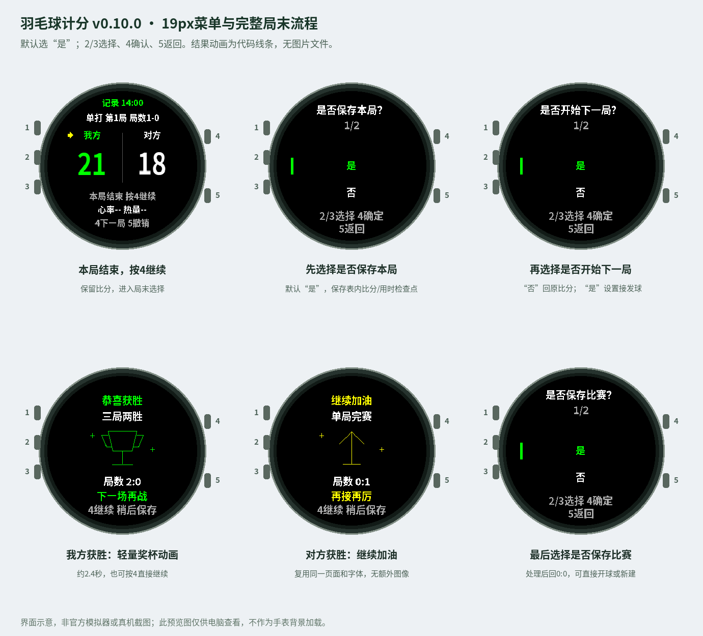
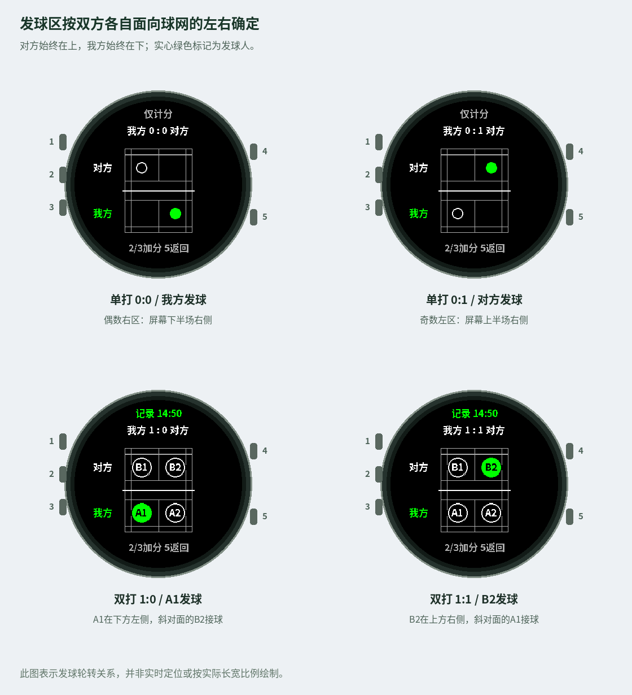

# 羽毛球计分器 v0.10.0 操作指南

[中文](USER_GUIDE_CN.md) · [English](USER_GUIDE_EN.md)

适用 Fēnix 6X Pro / Solar，工程目标 fenix6xpro。2026 年 11 月 11 日。场地图保留 A1/A2/B1/B2，提供计分、接发球轮转、运动数据和黑底绿色界面。

## 1. 比赛流程

4键根据比赛阶段进入场地图、下一局设置或比赛结果。应用使用线条场图、中文菜单与普通运动FIT记录；自定义FIT字段默认关闭。

| 当前状态 | 按4后的流程 |
| --- | --- |
| 正常打球 | 开始本球，显示接发球站位 |
| 一局结束，整场还没分胜负 | 是否保存本局 → 是否开始下一局 → 选择接发球 → 下一局0:0准备 |
| 单局赛已结束，或三局两胜已分胜负 | 胜利/加油页面 → 是否保存比赛 → 处理后0:0准备 |

本说明中，“一球”是一次得分回合，“一局”按21/15/11分制，“一场比赛”是单局赛或三局两胜。三局两胜一方先赢两局就结束，不强制打满三局。

预览图仅电脑查看，位于resources之外，不会作为手表背景加载。图片由实际绘制指令生成，非官方模拟器或真机截图。

## 2. 本局结束后的闭环

以21:18结束第一局、整场还未结束为例。

1. 比分页显示“本局结束 按4继续”，下方提示“4下一局 5撤销”。
2. 按4，进入“是否保存本局？”，只有是/否，默认选中是。
3. 选是，保存本局比分、用时检查点；选否，不单独保存这一检查点。两者都不会撤销本局胜负或清掉当前比分。
4. 接着显示“是否开始下一局？”，也是是/否，默认是。
5. 选否，关闭选择页，回到原来的21:18比分，局数不变。可以查看，也可按5纠分撤销。
6. 再按4，会重新从是否保存本局开始；默认仍选是。重复保存替换同一局的检查点，不会产生重复记录。
7. 选开始下一局的是，继续设置发球方、发球人和接球方/接球人，选择完成后才进入下一局0:0准备状态。

在第一问按5直接回原比分；后续设置中按5只退一层，尚未确认接球人时不会清分或推进局号。菜单里的比赛设置 → 下一局进入同一确认流程。

21:20在21分制中尚未结束，正常开球；需两分领先或达到30分封顶。15分练习制封顶21分，11分练习制封顶15分。

## 3. 下一局选择接发球

| 模式 | 选择顺序 |
| --- | --- |
| 单打 | 发球方（我方/对方）→ 接球方（另一方，确认）→ 下一局0:0 |
| 双打 | 发球方 → 发球人（该队A1/A2或B1/B2）→ 接球人（另一队两人中选一人）→ 下一局0:0 |

发球方默认上一局获胜方，也允许你明确手动改为另一方。球员编号保持固定，选择后0分为偶数，发球人在自己右区、接球人在斜对面。下一局比分、接发球和局号一起提交，不会选择到一半就改变上一局。

回到0:0后，按4正式开球并显示场地图。下一局准备阶段不计入该局用时，整场运动仍使用同一条记录。暂停状态不会被偷偷解除，需要先继续记录；锁定时需先解锁。

如果误进入下一局，可在0:0比分页按5，一次撤销整个下一局操作，回到上一局的局末比分和站位。之后又可按4重新选择。

## 4. 整场结束、胜利或加油

单局赛打完，或三局两胜一方已赢两局，比分页提示“4查看结果 5撤销”。此时4不会进入不存在的下一局。

1. 按4，若我方获胜显示绿色“恭喜获胜”与线条奖杯；对方获胜则显示黄色“继续加油”和向上箭头。
2. 页面复用现有字体与少量星光线条，约2.4秒后自动转到保存确认。按4可立即跳过，5也可进入保存确认。
3. 显示“是否保存比赛？”，是/否，默认选是，必须由你确认，不会因动画结束自动保存。
4. 选是，保存当前普通运动FIT及整场比分、各局用时和结果，回0:0初始准备状态，应用保持打开。
5. 选否，丢弃当前尚未保存的运动，不新增这场归档，同样回0:0；之前已经保存的活动和上一场归档不删除。
6. 准备状态按4可直接开始同格式新比赛，也可长按2 → 新建比赛重新选单双打、分制和接发球。

在整场保存确认页按5会回到最终比分，保留比赛。再按4可重新查看结果并确认保存。决胜局直接并入整场保存，不再重复询问一次本局保存。

保存出错会保留最终比分和运动会话，显示错误。按5回确认页后重试；如果FIT已经成功、只是比分归档出错，重试不重复生成同一条FIT。

手动中途结束使用菜单的结束对局入口，它终止整场，不是自然局末的下一局操作。退出应用是真正退出，和留在应用准备下一场分开。

## 5. 按键对应关系

左侧从上到下为1 LIGHT、2 UP/MENU、3 DOWN；右侧上方4 START，下方5 BACK。

| 键 | 打球比分/场地图 | 局末或整场比分 | 选择菜单 |
| --- | --- | --- | --- |
| 1 | 背光 | 背光 | 背光 |
| 2短按 | 我方+1，回比分 | 终局不再加分 | 上移循环 |
| 3短按 | 对方+1，回比分 | 终局不再加分 | 下移循环 |
| 4短按 | 开球看站位 | 下一局流程或结果页 | 确定 |
| 5短按 | 场图回比分；比分页撤销 | 撤销最近动作 | 上一层；特定确认页回比分 |
| 长按2 | 菜单 | 菜单 | 保持 |

每球只按一次2或3，核对后按4继续；建议每场先按4，让第一球就开始运动记录。比分页可以纠分，运动数据/时钟页2和3不计分，5回比分。

一级菜单包括新建比赛、比赛设置、数据页面、运动记录、按键锁定、结束对局、退出应用。正常菜单循环和逐层返回保持；自然局末不再需要长按菜单寻找下一局。

## 6. 场地图、轮转和撤销

对方在上，我方在下。单打发球人绿色实心、接球人白色空心；双打保留A1本人、A2队友、B1/B2对方，只有发球人绿色，其余统一白色。

| 队伍 | 自己右区 | 自己左区 |
| --- | --- | --- |
| 我方，下半场 | 屏幕右侧 | 屏幕左侧 |
| 对方，上半场 | 屏幕左侧 | 屏幕右侧 |

偶数分从发球方自己的右区，奇数分从自己的左区。图是轮转提示，非实时定位，不要求其他队员必须站在那里。换实际场地后，屏幕仍固定我方在下。

比赛设置 → 修改接发球可以在非零比分更正，比分、局数和黄色得分箭头保持；后续轮转接续新配置。

场地图5只返回，比分页5才撤销。若撤销了局末最后一分，本局旧检查点会失效，重打结束后再保存，避免把旧的21分结果留作本局快照。刚进入下一局时一次5会撤销整个新局提交。最多64个撤销动作的限制保持。

锁定只锁计分，不暂停运动；解锁与继续记录分别操作，恢复旧比分不强制锁定。

## 7. 本局保存与整场保存的区别

本局的是/否控制一个单独的表内检查点，包含比分、用时和计时完整性。每局最多一份，重复选择是只更新，不追加；选否会取消该局单独检查点。

为支持三局两胜和回到原比分，应用保留必要的比赛进度。选否不会撤销得分、改变谁赢本局，也不停止运动记录。各局比分中可看到已保存/未单存状态。

最后选择保存比赛的是，保存整场汇总，包括各局结果，即使之前有某局没有单独存检查点；这是整场保存的确认。最后选否则不新增整场归档，当前检查点也随准备状态清空。此前保存过的历史运动不能追溯删除。

普通运动FIT整场统一结束时保存，局间继续记录，不把每局拆成不同运动。表内详细比分与手机Connect自定义比分是不同功能；本版默认关闭自定义FIT字段。普通心率、热量和运动时长记录保持。

比赛设置 → 各局比分看当前进度，→ 上场比赛看最后一次保存的场次。只保留最后一场归档，不是无限历史库。普通系统退出使用中断恢复策略，异常断电、崩溃不保证保存。

## 8. 计时和暂停

| 时间 | 统计范围 |
| --- | --- |
| 每局用时 | 本局实际开始至结束，排除局间等待和手动暂停；局内查看菜单计入 |
| 对局总用时 | 包含局间休息，排除手动暂停；自然完赛后停止 |
| 原生运动时长 | 运动会话到保存的时长，可能包含完赛后动画和保存确认的等待 |

下一局接发球选择后先准备，按4才开始计该局时间。运动被暂停时按原流程继续记录；开启下一局不会自动解除暂停。

恢复没有历史时间的旧比分时仍标记未知，不补造数据。中断恢复保留已累计时间，不计应用关闭间隔；按4继续后重新计时。

通过活动会话读取心率、热量估算和时间。未获得心率显示--，通常稍等后出现，不增加Sensor权限。

## 9. 菜单字号、手机设置和资源

菜单文字默认为19像素，标题、条目、计数与按键提示统一增大；长文字最多两行，不自动退回小字号。比赛比分、场地图与球员标号保留现有字号。通过Connect IQ商店安装后，可在手机应用设置中选择19像素或16像素；应用运行时收到设置变化会刷新菜单，下次启动也会读取设置，不改变比分或运动会话。USB侧载只包含PRG，不能单独注册手机设置页。详细步骤见 [商店发布与手机设置](CONNECT_IQ_CN.md)。

胜利/加油效果由Graphics线条直接绘制，只有两种星光位置交替，使用400毫秒计时器、最多6个绘制帧，之后切回普通确认页。按4跳过或页面隐藏会停止动画节奏，不保留帧列表，不创建位图缓冲。

没有新增PNG、GIF或动画文件，复用同一个选择页面，缓存16px标签字库与19px菜单字库，大比分使用原生数字字体。场地图也只有线、圆点和编号。预览大图和说明图在resources之外，不会作为背景装进手表界面。

单局检查点固定3个位置，撤销仍最多64步；下一局预设只复制当前状态和少量结果，复用不可变历史快照，避免临时深拷贝整份撤销历史。

GarminRecordingBackend 的 ENABLE_MATCH_FIT_EXPORT=false，默认不调用 createField。可选13字段扩展属于开发功能，公开默认配置不启用。

上述是资源控制设计与模拟检查结果，不等于真实堆内存测量。本环境无Garmin SDK，需要本机模拟器和目标真机检查内存峰值与刷新效果，不能承诺任何状态下都绝不超过设备内存。

## 10. 普通运动与手机

PC构建PRG → USB安装手表 → 真机开始并保存普通运动 → Garmin Connect同步。不能把MC源码直接导入手机安装；模拟器记录也不会自动同步手表或手机。

本版使用通用GENERIC类型、名称羽毛球，可能归入其他活动；不启用GPS，不承诺室内距离或全部原生训练算法。关闭详细比分上传不关闭普通运动记录，表内比分和用时可以查看。

建议真机做两分钟验证：按4开球，稍等看心率，测试局末/整场保存后，在手表历史及手机全部活动核对。这个环境没有验证真实FIT或手机同步。

## 11. Windows安装、模拟与手表使用

1. 从项目 Releases 下载 `garmin-badminton-score-v0.10.0-source.zip`，完整解压到一个本地目录。VS Code 选择“文件 → 打开文件夹”，打开包含 manifest.xml 和 monkey.jungle 的工程根目录。MC 文件是源代码，应使用 Visual Studio Code 打开。
2. 安装 Garmin 官方 Monkey C 扩展、Connect IQ SDK Manager，以及当前工具链要求的 Java 环境。在 SDK Manager 下载 SDK 并设为当前 SDK，下载 `fenix6xpro` 设备包。
3. 在 VS Code 按 Ctrl+Shift+P，运行 `Monkey C: Verify Installation`。如果失败，先确认当前 SDK 和设备包，再重载 VS Code 窗口。SDK 与设备包不需要放在工程目录。
4. 使用扩展的 Developer Key 设置选择自己的签名密钥；首次使用可通过扩展的生成密钥命令创建。将私钥保存在工程之外，自己备份，不上传 GitHub、不交给别人。后续构建继续使用同一把密钥。
5. 打开 source/BadmintonApp.mc，按 Ctrl+F5，选择 fenix6xpro。等编译成功、模拟器启动后，通过鼠标点击模拟器侧面的五个按键操作。双击 MC 文件不会启动模拟器。
6. 在模拟器中先按4开始，按2/3测试计分、按4查看场图、按5返回；长按2进入菜单。选择单局赛可快速验证胜负与保存流程，三局两胜用于验证下一局设置。模拟器中的活动不等于手表活动，也不会直接上传手机。
7. 使用 `Monkey C: Run Tests` 执行随工程提供的25个原生格式测试。Node逻辑检查与官方测试是独立的验证层。
8. 使用 `Monkey C: Build for Device` 选择 fenix6xpro，生成面向真实设备的 PRG。命令名称可能随扩展版本略有变化，请在命令面板搜索 Monkey C。不要将模拟器专用目标构建的文件用于真机。
9. 用支持数据传输的 USB 线连接手表，结束手表当前正在运行的活动。将构建生成的 PRG 复制到手表的 `GARMIN/APPS` 目录，安全弹出并断开。手表活动列表中打开“羽毛球计分”；必要时在活动列表的添加选项中查找。
10. 真机按4开始并选择记录运动，等待心率出现。结束比赛选择保存。连接已配对的 Garmin Connect 手机应用并同步，在全部活动中核对记录。源码与 PRG 不能直接通过手机的文件导入功能安装。

源码包已附带中文点阵字库，正常构建不需要 Python，也不需要重新生成字体。工程不包含 SDK、私钥、已编译 PRG 或 IQ。完整替换源码与资源，保留应用 ID；请勿将 docs/assets 中的预览图片放入 resources。

## 12. 验收和验证边界

1. 一局结束提示4下一局。第一、第二问默认是；下一局否返回原比分，按4可重复进入。
2. 接发球选择完成前不清分、不推进局号；完成后0:0，保留原胜局数。
3. 单打接球方是另一方；双打可选具体四人，场图偶数右区正确。
4. 取消/返回/保存失败不会误开下一局；重复保存不会重复追加；下一局一次撤销可回上一局。
5. 21:20不提前结束；三局两胜先赢两局即结束，单局直接整场结束。
6. 结果页约2.4秒，4可跳过；动画结束只进确认，不自动保存。最终保存失败保留比分可重试。
7. 整场是/否后回准备，可直接4开球或新建；普通运动及默认不分配自定义字段。
8. 中文、循环菜单、心率、场地图、按键锁定、暂停与数据页面正常；检查真实内存和同步。

发布验证结果、运行命令与未执行项目见仓库根目录 VALIDATION.md。Node 检查使用适配后的同份源码与模拟 Garmin API；不等于 Garmin 编译器、官方模拟器或真实设备验收。安装前应完成本机 SDK 编译与目标真机验证。

## 13. 参考资料

- [Garmin团队关于字段数量限制及不可恢复错误的说明](https://forums.garmin.com/developer/connect-iq/f/discussion/234758/what-is-the-limiting-number-of-developer-fields-that-can-be-added-under-session/1115429)
- [近期createField无法捕获的System Error讨论](https://forums.garmin.com/developer/connect-iq/f/discussion/405510/hange-datalabel-for-fit-fields/1907522)
- [Session记录、保存、丢弃与字段字节限制](https://developer.garmin.com/connect-iq/api-docs/Toybox/ActivityRecording/Session.html)
- [Garmin FIT团队关于Connect显示元数据的解释](https://forums.garmin.com/developer/fit-sdk/f/discussion/255702/fit-file-developer-data-looks-correct-but-does-not-display-in-garmin-connect/1950795)

