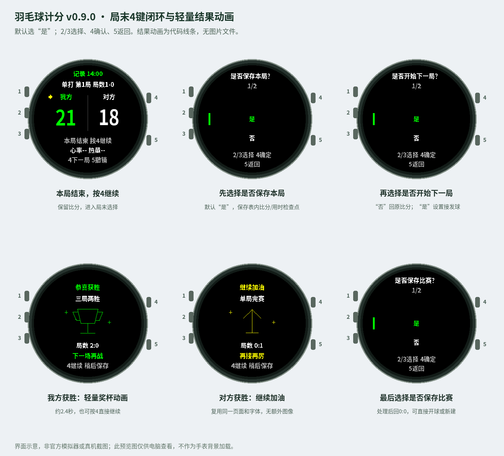
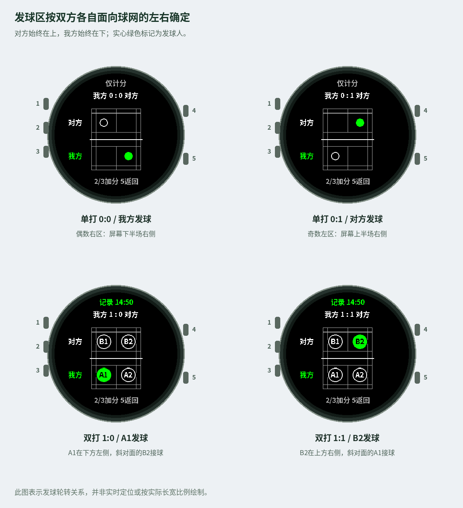

# Garmin Badminton Score v0.9.0 — User Guide

[中文](USER_GUIDE_CN.md) · [English project overview](../README_EN.md)

For Fēnix 6X Pro / Solar, device target `fenix6xpro`. The watch interface uses Chinese labels; player identifiers remain A1/A2/B1/B2. The translations below explain those labels.

## 1. Match flow

A rally is one point, a game uses the selected points format, and a match is one game or best of three. In best of three, the match ends as soon as either side wins two games.

| State | Press button 4 |
| --- | --- |
| Game in progress | Start the rally and show the service court |
| Game ended, match continues | Save game? → Start next game? → Service setup → 0:0 ready |
| Match ended | Win/encouragement screen → Save match? → Ready |

These illustrations are reconstructed from drawing commands, not screenshots of a Garmin simulator or watch. The large documentation images are outside runtime resources.

## 2. Completing a game

For example, after game one ends at 21:18:

1. The scoreboard displays 本局结束 (Game ended) and a prompt to press 4.
2. Press 4 to open 是否保存本局？ (Save this game?). There are two choices: 是 (Yes) and 否 (No). Yes is selected by default.
3. Yes stores a local score/time checkpoint for this game. No omits that separate checkpoint. Neither choice cancels the game win or clears the terminal score.
4. The next screen asks 是否开始下一局？ (Start the next game?), again defaulting to Yes.
5. No returns to the same 21:18 scoreboard, with the same game wins. You can inspect it or press 5 to undo a scoring mistake.
6. Press 4 again to repeat the flow. Saving the same game replaces its checkpoint rather than appending a duplicate.
7. Yes proceeds to service setup. The next game is committed only after the receiver is confirmed.

Button5 at the first question returns to the scoreboard. In subsequent setup steps it moves back one level. The menu entry for the next game uses the same confirmation flow.

At21:20 a 21-point game is still in progress: a two-point lead is required, with a 30-point cap. The15- and 11-point practice formats cap at 21 and 15 respectively.

## 3. Setting up the next service

| Mode | Selection sequence |
| --- | --- |
| Singles | Serving side → Confirm the other side as receiver → 0:0 |
| Doubles | Serving side → Specific server → Opposing receiver → 0:0 |

The previous game's winner is the default serving side. You may explicitly override that choice. At0:0, the server uses their own right service court and the receiver is diagonally opposite. Player identifiers remain fixed throughout the match.

Setup is staged: going back before receiver confirmation does not clear the previous score or advance the game number. After confirmation, press 4 at 0:0 to start the first rally. Waiting in this ready state is excluded from that game's timer. The overall activity session continues across games.

If you accidentally prepare the next game, press 5 once on its 0:0 scoreboard to undo the grouped transition and restore the previous game's terminal score and lineup. Paused recording and scoring lock must be resumed/unlocked separately.

## 4. Completing a match

A one-game match ends after its game. A best-of-three match ends after one side wins two games. The final scoreboard offers4 for results and 5 for undo.

1. Press 4. An own-team win shows 恭喜获胜 (Congratulations!) with a green trophy; an opponent win shows 继续加油 (Keep going!) with a yellow arrow.
2. The lightweight effect lasts about2.4 seconds. Press 4 or5 to skip it.
3. The next screen asks 是否保存比赛？ (Save the match?), with Yes selected. The animation never selects or saves on your behalf.
4. Yes saves the pending ordinary FIT activity and the match archive, including game scores and times, then returns to 0:0 ready without closing the app.
5. No discards the currently unsaved activity and does not create a new match archive, then returns to ready. Previously saved activities and the last archived match are not deleted.
6. From ready, press 4 to start another match with the same format, or hold 2 and choose 新建比赛 (New match) to reconfigure it.

Button5 at the final save question returns to the final scoreboard. Press 4 again to reopen the results flow. A deciding game is included in the match confirmation; there is no duplicate game-save question.

A save error preserves the score and session for retry. If FIT saving succeeded but local archiving failed, retrying does not save a duplicate FIT. The menu's 结束对局 (End match) handles an early manual finish; 退出应用 (Exit app) actually closes the app.

## 5. Five-button operation

Left side, top to bottom:1 LIGHT,2 UP/MENU,3 DOWN. Right side:4 START above5 BACK.

| Button | Scoreboard / court | Game or match ended | Menu |
| --- | --- | --- | --- |
| 1 | System backlight | System backlight | System backlight |
| 2 short | Own team +1; return to score | No extra points | Move up, wrapping |
| 3 short | Opponent +1; return to score | No extra points | Move down, wrapping |
| 4 short | Start rally / court view | Next-game or results flow | Confirm |
| 5 short | Court → score; score → undo | Undo recent action | Back one level |
| Hold 2 | Open menu | Open menu | No scoring action |

After each rally, press 2 or3 once, check the score, then press 4. Start the first rally with 4 so activity recording starts from the beginning. Buttons2/3 do not add points on the data/clock pages;5 returns to the scoreboard.

| Chinese menu label | Meaning |
| --- | --- |
| 新建比赛 | New match |
| 比赛设置 | Match settings |
| 数据页面 | Data pages |
| 运动记录 | Activity recording |
| 按键锁定 | Scoring lock |
| 结束对局 | End match |
| 退出应用 | Exit app |
| 接发球 | Service / reception |
| 记录 | Recording |
| 是 / 否 | Yes / No |

Ordinary menus wrap at the top and bottom. Button5 returns one level; at the root it closes the menu without undoing a point.

## 6. Court view, rotation and undo

The opponent is always above the net; your team is below. In singles, the green filled marker is the server and the white outlined marker is the receiver. In doubles, A1 is the wearer, A2 their partner, and B1/B2 their opponents. Only the server is green.

| Side | Player's own right court | Player's own left court |
| --- | --- | --- |
| Own team, lower half | Screen right | Screen left |
| Opponent, upper half | Screen left | Screen right |

Even scores serve from the server's own right court, odd scores from their left. The illustration is a service/rotation guide, not live position tracking. The display keeps your team below even after changing physical ends.

Match settings let you correct the current server/receiver at a nonzero score. Scores, game wins and the yellow last-scoring-side arrow are preserved; subsequent rotation follows the edited lineup.

Button5 on the court only returns to the score. On the scoreboard it undoes. Undoing a game-winning point invalidates that game's saved checkpoint. Undo history is limited to 64 actions. Scoring lock does not pause activity recording; unlocking and resuming are separate controls.

## 7. Game saves and match saves

A game-save choice controls a separate local checkpoint containing score, duration and timing completeness. There is at most one per game, up to three games. Yes replaces it; No removes that game's separate checkpoint.

The app retains the progress needed to continue a best-of-three match. Choosing No does not undo the result, reset the score or stop recording. The game-score page indicates the separate checkpoint status.

Choosing Yes at the final match question archives all game results, including games without separate checkpoints. Choosing No creates no new match archive and clears current checkpoints when returning to ready. Already saved activities cannot be deleted retrospectively by this choice.

One ordinary FIT activity spans the match; game-save choices do not split it into separate activities. Detailed scores and game times stay in the watch app. Custom FIT fields are disabled by default, so detailed score charts are not provided in Connect.

Match settings provide current game scores and the last saved match. Only the last match archive is retained. Ordinary system exit attempts interruption recovery; recovery after a crash or sudden power loss is not guaranteed.

## 8. Timing, heart rate and pause

| Time | What it includes |
| --- | --- |
| Game duration | First rally start to game end; excludes between-game preparation and manual pauses; in-game menu time counts |
| Match duration | Includes breaks between games, excludes manual pauses; stops at natural match completion |
| Native activity duration | Session duration until save; may include result-screen and confirmation waiting |

The next game's timer starts with 4 after setup. It does not automatically resume paused activity recording. Recovery keeps accumulated known time and excludes the app-closed interval. Missing historical timing stays unknown rather than being invented.

Unavailable heart rate displays `--`; wait for valid sampling on the actual watch. Current/average/maximum heart rate, calories, duration and a clock are available on data pages when the device supplies them.

## 9. Graphics and memory

The result effect uses drawing primitives, existing fonts, a 400 ms timer and at most six frames. Skipping or hiding stops it. There is no retained frame-image list or full-screen bitmap buffer.

Courts use lines, markers and identifiers. A single 16 px Chinese bitmap font is cached; scores use device number fonts. Documentation previews remain outside the runtime resource path. Game checkpoints and undo history are bounded; staged setup reuses immutable history snapshots.

`ENABLE_MATCH_FIT_EXPORT=false` in GarminRecordingBackend keeps custom field allocation disabled. The optional13-field implementation is a development feature, not the public default.

These controls and mocked drawing checks do not establish native heap usage. Measure peak memory and visual behavior in the official simulator and target watch; no universal memory-fit guarantee is claimed.

## 10. Activity recording and your phone

Build device PRG on a computer → Install on watch over USB → Start and save an actual activity → Synchronize Garmin Connect.

MC source cannot be imported into the phone to install the watch app. Simulator activities do not automatically synchronize to a physical watch or phone. The activity uses GENERIC sport type and the name 羽毛球; it may appear as Other. GPS is not enabled, and indoor distance or all native training metrics are not promised.

Perform a short real-watch check: press 4 to start, wait for heart rate, finish and save, then inspect watch history and Connect's full activity list. Ordinary activity synchronization and local match archiving are separate features.

## 11. Installation and native testing

1. Download the full source ZIP and extract it. Open the directory containing manifest.xml, monkey.jungle, source and resources in VS Code.
2. Install Garmin's official Monkey C extension, SDK Manager and the Java environment required by the toolchain. Select a current SDK and download `fenix6xpro`.
3. Run `Monkey C: Verify Installation`. Configure your own Developer Key outside the project; back it up and never upload it.
4. Open source/BadmintonApp.mc → Ctrl+F5 → fenix6xpro. Click the simulator's side buttons to operate the app.
5. Verify ordinary scoring, menus, lock/unlock, game-end No/re-entry, service setup, wins/losses, final save/discard and recovery.
6. Run `Monkey C: Run Tests` for the 25 supplied native-format tests. Actual results depend on your local SDK execution.
7. Use `Monkey C: Build for Device` for fenix6xpro. Do not install a simulator-target PRG on the real watch.
8. Connect a data-capableUSB cable, finish any active watch activity, copy the device PRG to `GARMIN/APPS`, safely eject and open 羽毛球计分 from the watch's activity list.
9. Start and save on the watch, then synchronize the paired Connect phone app.

The package includes the prebuilt Chinese font, but no SDK, key, PRG orIQ. Python is not needed for a normal Garmin build. Keep the appID and your signing key consistent for updates. Do not copy documentation previews into resources. See [Installation](INSTALL_EN.md).

## 12. Acceptance and validation boundary

Verify default-Yes questions, No returning to the original score, staged service configuration, correct parity, grouped undo,21:20 continuation, best-of-three ending after two wins, skippable bounded effects and final confirmation without automatic saving.

Also verify save/discard returning to ready, retry without duplicate FIT, wrapping menus, BACK navigation, Chinese glyphs, lock/unlock and pause behavior. Measure native memory and test actual phone synchronization.

The release preparation checks comprise160 adapted-source/mocked-API checks. They do not replace official compilation, native tests, simulator execution or physical-device testing. See [Validation](VALIDATION_EN.md) for the exact scope.

## 13. References

- [Garmin Connect IQ getting started](https://developer.garmin.com/connect-iq/connect-iq-basics/getting-started/)
- [ActivityRecording.Session API](https://developer.garmin.com/connect-iq/api-docs/Toybox/ActivityRecording/Session.html)
- [Garmin discussion of developer-field limits](https://forums.garmin.com/developer/connect-iq/f/discussion/234758/what-is-the-limiting-number-of-developer-fields-that-can-be-added-under-session/1115429)
- [Garmin FIT discussion of Connect display metadata](https://forums.garmin.com/developer/fit-sdk/f/discussion/255702/fit-file-developer-data-looks-correct-but-does-not-display-in-garmin-connect/1950795)
